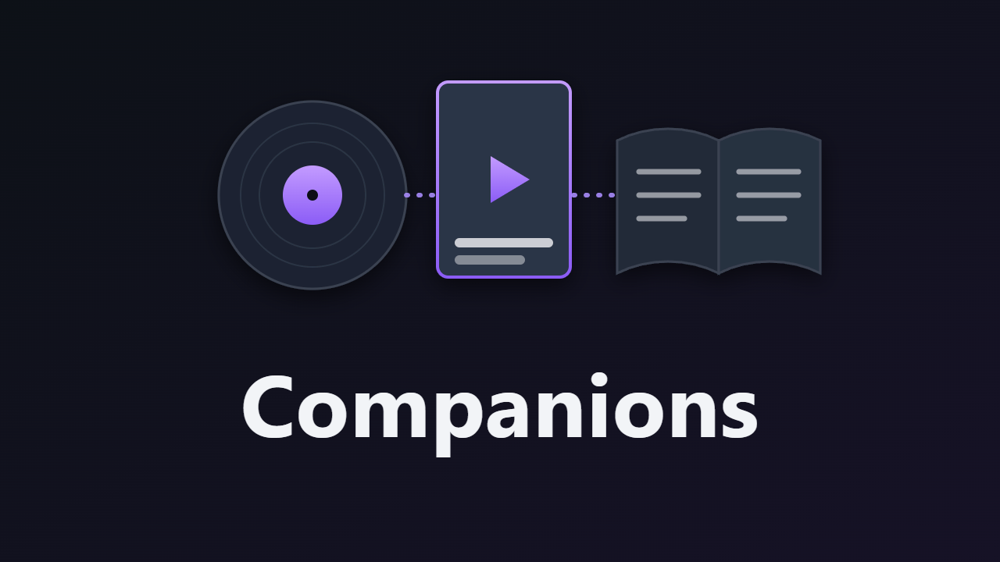

# Companions – Jellyfin-Plugin (Jellyfin 12.x)



Verknüpft Filme und Serien mit dem, was sonst noch dazugehört:

- **Soundtrack:** Auf der Film- oder Serienseite erscheint eine Zeile „Soundtrack“ mit den passenden Alben aus deinen Musikbibliotheken. Auf der Albumseite steht umgekehrt „Zum Film“ bzw. „Zur Serie“.
- **Buchvorlage:** Eine Zeile mit dem Buch, E-Book oder Hörbuch aus deinen Buchservern. Ein Klick öffnet es dort. Unterstützt werden:
  - **Audiobookshelf** (API-Token, ab Version 2.26)
  - **Kavita** (Auth Key)
  - **Grimmory** (früher BookLore; OPDS-Benutzer)
  - **BookOrbit** (OPDS-Benutzer)
  - jeder andere **OPDS-Katalog** mit Suche
- Staffeln und Episoden zeigen Soundtrack und Buchvorlage ihrer Serie.

## Wie der Abgleich funktioniert

### Soundtracks

Alles bleibt lokal in Jellyfin. Ein Album gilt als Soundtrack eines Films, wenn alle drei Bedingungen erfüllt sind:

1. Sein Name ohne Zusätze ist der Titel oder der Originaltitel des Films. Zusätze sind z. B. „(Original Motion Picture Soundtrack)“, „OST“, „Music from …“ oder „Vol. 1“. So passt „The Lord of the Rings: The Fellowship of the Ring (Original Motion Picture Soundtrack)“ auch zu „Der Herr der Ringe – Die Gefährten“, weil der Originaltitel stimmt.
2. Es ist als Soundtrack erkennbar, entweder am Namen oder am Genre (Soundtrack, Score, Filmmusik …).
3. Das Erscheinungsjahr passt: höchstens ein Jahr vor bis zwei Jahre nach dem Film, bei Serien innerhalb der Laufzeit.

Klaus Schulzes Album „Dune“ von 1979 erkennt das Plugin deshalb nicht als Soundtrack zu *Dune* (2021), den Soundtrack von 1984 auch nicht.

### Bücher

Jellyfin übernimmt von TMDB die Vorlage samt Autor in die Mitwirkenden, z. B. „Frank Herbert – Novel“. Außerdem kommen Schlagwörter wie „based on novel or book“ als Tags. Das Plugin nutzt beides:

- Gefragt werden die Buchserver nur bei Verfilmungen, also bei Titeln mit Vorlagen-Autor oder einem „based on …“-Tag. Das lässt sich abschalten.
- **Mit Vorlagen-Autor:** Das Buch muss von diesem Autor sein. „J. R. R. Tolkien“, „J.R.R. Tolkien“ und „Tolkien, J. R. R.“ gelten als gleich. Der Titel muss passen: gleich, gleich bis auf einen Untertitel („Dune: Der Wüstenplanet“), oder Teil des Filmtitels („Die Gefährten“ in „Der Herr der Ringe – Die Gefährten“). „Dune Messiah“ gehört deshalb nicht zu *Dune*, und ein „Dune“ von einem anderen Autor auch nicht.
- **Ohne Vorlagen-Autor:** Nur ein exakt gleicher Titel zählt.
- **Buchreihe:** Statt des Titels darf auch der Name der Buchreihe passen. *Silo* findet so „Wool“, „Shift“ und „Dust“ aus der Reihe „Silo“, in Reihenfolge. Audiobookshelf, Grimmory und BookOrbit liefern den Reihennamen mit. In Kavita ist eine Reihe ohnehin ein einziger Eintrag.
- **Titel in anderen Sprachen:** Jellyfin kennt nur den Titel in der Sprache der Bibliothek und den Originaltitel. Bücher und Manga liegen aber oft unter dem englischen Titel oder dem der deutschen Ausgabe auf dem Server. Das Plugin fragt diese Titel einmal pro Titel über Jellyfins eigenen TMDB-Anbieter ab (kein eigener API-Schlüssel, Standard: `en, de`) und sucht auch damit. *Atelier of Witch Hat* findet so „Witch Hat Atelier“ und umgekehrt. Abschaltbar.
- **Bände:** Bandnummern zählen beim Titelvergleich nicht („Witch Hat Atelier, Vol. 3“, „Witch Hat Atelier v03 (2019) (Digital)“, „Atelier of Witch Hat 2“). Klammerzusätze wie „(Digital)“ erscheinen nicht auf den Karten. Mehr als vier Bände einer Reihe auf einem Server erscheinen als eine Karte mit der Zahl der Bände.
- Autorennamen passen in jeder Reihenfolge („Liu Cixin“ = „Cixin Liu“), Zahlen und Zahlwörter gelten als gleich („3 Body Problem“ = „The Three-Body Problem“).

Gesucht wird mit dem Titel, dem Originaltitel, deren Haupttitel und dem Nachnamen des Autors. Die Ergebnisse speichert das Plugin 12 Stunden zwischen (einstellbar). Fehlgeschlagene Abfragen wiederholt es nach 10 Minuten. Die Cover lädt der Jellyfin-Server mit den Zugangsdaten des Buchservers und reicht sie weiter. Der Browser braucht also keinen Zugang zu den Buchservern, nur für die Links.

## Einstellungen

*Dashboard → Plugins → Companions*

| Einstellung | Standard | Bedeutung |
|---|---|---|
| Show the rows in the web client | an | Hauptschalter |
| Link soundtracks … | an | Soundtrack-Zeile und „Zum Film“ auf Albumseiten |
| Link books and audiobooks … | an | Buch-Zeile |
| Only look up adaptations | an | Buchserver nur bei Verfilmungen fragen |
| Also search the English title | an | englischen Titel über Jellyfins TMDB-Anbieter nachschlagen und mitsuchen |
| Keep lookups for (hours) | 12 | Zwischenspeicher für Buchabfragen |

Für jeden Buchserver gibt es folgende Einstellungen:

| Feld | Bedeutung |
|---|---|
| Kind | Audiobookshelf, Kavita, Grimmory, BookOrbit oder anderer OPDS-Katalog |
| Address used by the Jellyfin server | z. B. `http://192.168.1.10:13378` |
| Address for links in the browser | wenn der Browser den Server unter einer anderen Adresse erreicht (Reverse Proxy); leer = gleiche Adresse |
| API token / Auth key | Audiobookshelf: *Einstellungen → API Keys*. Kavita: *Konto → Auth Keys* |
| OPDS user / password | Grimmory und BookOrbit: OPDS in den Einstellungen einschalten und dort einen OPDS-Benutzer anlegen |
| OPDS catalog path, Web page of a book | nur für andere OPDS-Kataloge; `{id}` steht für die Buch-ID |

**Test connection** prüft Adresse und Zugang, ohne zu speichern. Für Administratoren zeigt `GET /Companions/Explain/{itemId}`, was das Plugin für einen Titel findet: die nachgeschlagenen Titel, die Suchbegriffe, die verlinkten Bücher und unter `notLinked` die Bücher, die ein Server gefunden hat, die aber nicht passten, jeweils mit Grund.

## Grenzen

- Die Zeilen erscheinen nur in der Weboberfläche (Browser, Jellyfin Media Player). Native Apps laden keine Plugin-Skripte.
- In den Buchservern selbst erscheint kein Link zurück zu Jellyfin.
- Kavita durchsucht nur Serientitel, nicht Autoren. Liegt ein Buch dort unter einem ganz anderen Titel als der Film, findet das Plugin es in Kavita nicht. In Audiobookshelf, Grimmory und BookOrbit findet es das Buch über den Autor.
- Getestet ist das Plugin gegen Nachbauten der vier Server-Schnittstellen, die ihrem Quellcode folgen (Audiobookshelf 2.37, Kavita 0.9, Grimmory 3.5, BookOrbit 3.7). Mit einer echten Installation ist es noch nicht gelaufen.

## Installation

### Über das Plugin-Repository (mit Updates)

1. *Dashboard → Plugins → Repositorys → +* und diese URL eintragen:
   `https://raw.githubusercontent.com/skriewel/jellyfin-companions/main/manifest.json`
2. Im Katalog **Companions** installieren, Jellyfin neu starten.

### Manuell

1. Ordner `dist\Companions_1.0.7.0` in das Plugin-Verzeichnis von Jellyfin kopieren.
2. Jellyfin neu starten, im Browser Strg+F5.

## Bauen

```powershell
.\build.ps1
```

## Neue Version veröffentlichen

1. Version in der `.csproj` und als Standardwert in `build.ps1` erhöhen, Changelog in `build.ps1` anpassen.
2. `.\build.ps1` ausführen: baut das Paket nach `dist\` und trägt die Version mit Prüfsumme in `manifest.json` ein.
3. Commit und Push, dann das GitHub-Release anlegen (Tag `v<Version>`, das ZIP aus `dist\` anhängen):
   `gh release create v<Version> dist\<Paket>.zip --title "<Name> <Version>"`
